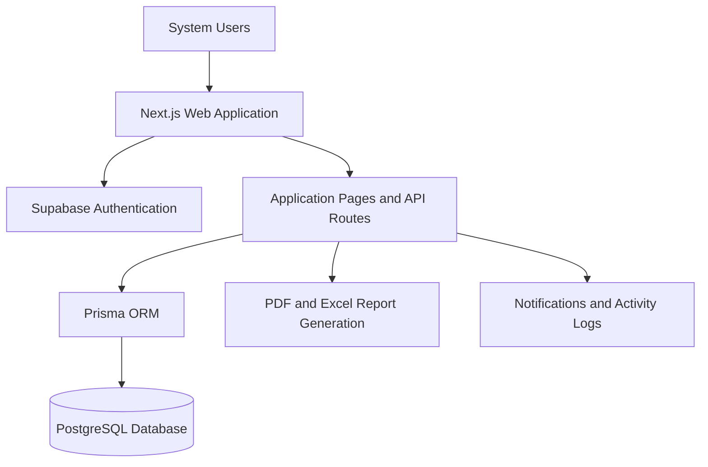
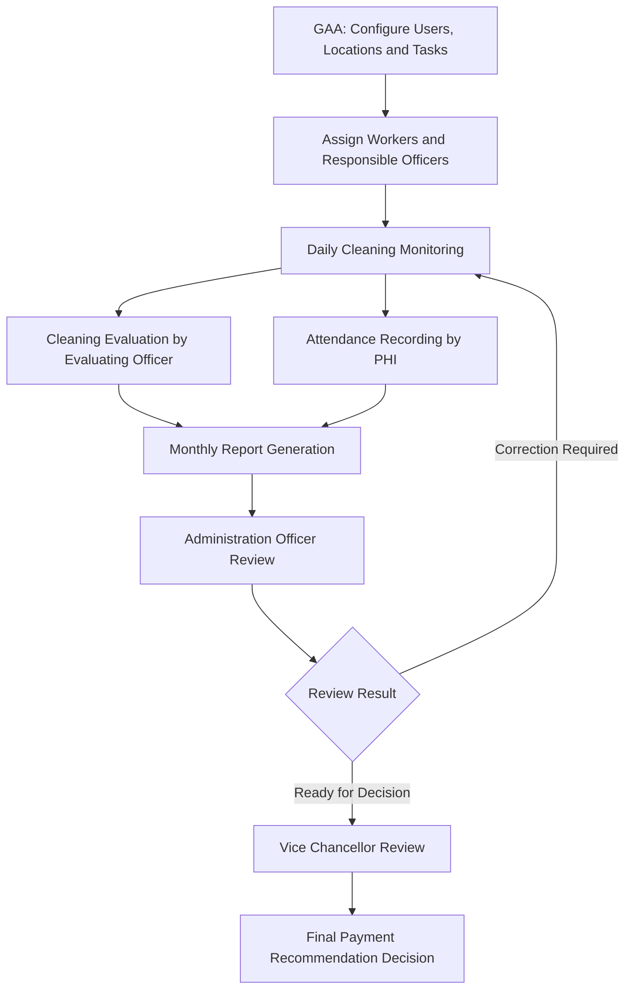

<div align="center">


# University Cleaning Management System

### A Centralized Platform for University Cleaning Operations

A role-based web application designed to manage university cleaning locations, daily evaluations, worker attendance, monthly reports, and payment approvals.

[](https://nextjs.org/)
[](https://react.dev/)
[](https://www.typescriptlang.org/)
[](https://tailwindcss.com/)
[](https://www.prisma.io/)
[](https://supabase.com/)

**Live Demo:** https://uni-cleaning-system.vercel.app/

</div>

---

## 📌 About the Project

The **University Cleaning Management System** is developed to digitize and simplify the management of cleaning operations within a university environment.

The system provides a centralized platform where administrative staff can manage cleaning locations, tasks, workers, and assignments. Evaluating Officers and PHI staff can record daily cleaning evaluations and worker attendance, while administrative officers can review monthly reports and process payment recommendations.

The application follows a role-based workflow to ensure that each user can access the functions relevant to their responsibilities.

## ✨ Key Features

### 1. User and Role Management
- User creation and account management.
- Role assignment and role-based access control.
- Account activation and deactivation.
- Separate dashboards and permissions for each role.

### 2. Location and Cleaning Task Management
- Manage university cleaning locations.
- Create cleaning tasks with daily, weekly, and monthly frequencies.
- Assign tasks to relevant locations.
- Configure task amounts and additional cleaning tasks.
- Allocate cleaning workers and responsible officers to locations.

### 3. Daily Cleaning Evaluation
- Record cleaning quality as Pass, Fail, or Not Applicable.
- Add remarks to daily evaluations.
- View evaluation records for assigned locations.
- Finalize daily evaluation records.

### 4. Worker Attendance Monitoring
- Record worker attendance as Present or Absent.
- Monitor attendance for assigned locations.
- Maintain attendance history.
- Finalize attendance records for monthly reporting.

### 5. Monthly Reports and Payment Workflow
- Generate monthly location-based reports.
- Summarize cleaning task evaluations and worker attendance.
- Calculate performance percentages and payment recommendations.
- Review reports and request corrections.
- Support final payment recommendation decisions.

### 6. Notifications and Audit Logs
- Notify users about report submissions and review decisions.
- Track notification read status.
- Maintain activity records for important system operations.

### 7. Report Generation
- Generate PDF reports.
- Export report information to Excel.
- Present monthly performance and payment-related summaries.

## 👥 User Roles

| User Role | Main Responsibilities |
|---|---|
| **GAA – General Administrative Assistant** | Manage users, locations, cleaning tasks, and staff assignments. |
| **Evaluating Officer** | Evaluate cleaning quality at assigned university locations. |
| **PHI** | Monitor and record worker attendance at authorized locations. |
| **Administration Officer** | Review monthly reports, request corrections, and process payment recommendations. |
| **Vice Chancellor** | Review and make final decisions on payment recommendations. |

## 🏗️ System Architecture

The application uses a Next.js-based web interface, Supabase services for authentication and PostgreSQL database hosting, and Prisma ORM for database access.



### Main Architecture Components

- **Frontend:** Next.js, React, TypeScript, and Tailwind CSS provide the user interface.
- **Authentication:** Supabase Auth manages user authentication.
- **Database:** PostgreSQL stores user, location, task, monitoring, reporting, and workflow information.
- **ORM:** Prisma provides structured database access.
- **Reporting:** PDFKit and ExcelJS support report exports.

## 🔄 System Workflow



1. **System setup:** GAA configures users, locations, tasks, and assignments.
2. **Daily operations:** Evaluating Officers record cleaning quality, while PHI staff record worker attendance.
3. **Report preparation:** Daily records are consolidated into monthly reports.
4. **Administrative review:** The Administration Officer reviews submitted reports and requests corrections when necessary.
5. **Final decision:** The Vice Chancellor reviews the payment recommendation and records the decision.

## 🛠️ Technology Stack

| Technology | Purpose |
|---|---|
| Next.js 16 | Full-stack web application framework |
| React 19 | User interface library |
| TypeScript 5 | Application programming language |
| Tailwind CSS 4 | Responsive UI styling |
| Supabase Auth | User authentication |
| Supabase PostgreSQL | Database hosting |
| Prisma ORM 7 | Database access and schema management |
| PDFKit | PDF report generation |
| ExcelJS | Excel report generation |
| Vitest | Automated testing |
| ESLint | Code quality and linting |
| Vercel | Application deployment |

## 📂 Project Structure

```text
uni_cleaning-system/
│
├── app/                    # Next.js application pages and API routes
├── lib/                    # Shared logic, authentication, and utilities
├── prisma/                 # Prisma schema, migrations, and seed files
├── public/                 # Static assets and public resources
├── tests/                  # Automated test files
├── .agents/                # Project agent skills
│
├── LOGIN_SETUP_GUIDE.md    # Authentication and initial user setup
├── PROJECT_BUILD_SUMMARY.md
├── package.json            # Dependencies and scripts
├── prisma.config.ts        # Prisma configuration
└── README.md
```

## ⚙️ Installation and Setup

### Prerequisites

- Node.js
- npm
- A Supabase project
- A PostgreSQL database configured through Supabase

### 1. Clone the Repository

```bash
git clone https://github.com/senath6932/uni_cleaning-system.git
cd uni_cleaning-system
```

### 2. Install Dependencies

```bash
npm install
```

### 3. Configure Environment Variables

Create a `.env` file in the project root:

```env
DATABASE_URL="your-supabase-pooled-database-url"
DIRECT_URL="your-supabase-direct-database-url"

NEXT_PUBLIC_SUPABASE_URL="your-supabase-project-url"
NEXT_PUBLIC_SUPABASE_PUBLISHABLE_KEY="your-supabase-publishable-key"

SUPABASE_SERVICE_ROLE_KEY="your-supabase-service-role-key"
```

> **Security:** Replace the example values with your own Supabase project credentials. Never commit your `.env` file or expose the service-role key in client-side code.

### 4. Set Up the Database

```bash
npx prisma migrate deploy
npx prisma generate
```

### 5. Run the Development Server

```bash
npm run dev
```

Open [http://localhost:3000](http://localhost:3000) to access the application.

For initial authentication and account setup, refer to [`LOGIN_SETUP_GUIDE.md`](./LOGIN_SETUP_GUIDE.md).

## 🧪 Testing

The project uses **Vitest** for automated testing of core application functionality, including user management, locations, cleaning tasks, assignments, monitoring, and role-based authorization.

Run the test suite:

```bash
npm run test
```

## 📜 Available Scripts

| Command | Description |
|---|---|
| `npm run dev` | Start the development server. |
| `npm run build` | Generate Prisma Client and build the application. |
| `npm run start` | Start the production server. |
| `npm run lint` | Run ESLint. |
| `npm run test` | Run automated tests. |
| `npm run seed` | Run the database seed script. |

## 🚀 Deployment

The application is deployed using **Vercel**.

**Live Application:** https://uni-cleaning-system.vercel.app/

For a separate deployment, configure the required environment variables and Supabase database connection in the Vercel project settings.

## 📖 Additional Documentation

- [`PROJECT_BUILD_SUMMARY.md`](./PROJECT_BUILD_SUMMARY.md) – project modules, features, roles, and implementation details.
- [`LOGIN_SETUP_GUIDE.md`](./LOGIN_SETUP_GUIDE.md) – authentication and initial account setup instructions.

---

<div align="center">

**University Cleaning Management System**

*Improving the coordination, monitoring, and accountability of university cleaning operations.*

</div>
